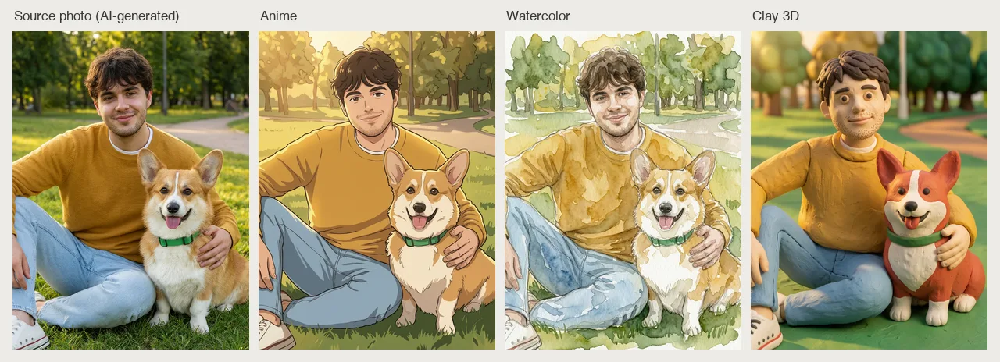

# Photo to Anime Skill

[English](./README.md) | 简体中文 | [日本語](./README.ja.md)

> 👉 也看看 [AI Headshot Generator Skill](https://github.com/beatra-ai/ai-headshot-generator-skill)

把照片转成漫画、动漫、卡通、水彩、黏土或 3D 角色画风，保住人物、宠物和商品的辨识度，同一套画风还能批量复用，在 Claude Code、Cursor、Codex、Windsurf、Cline 或 OpenClaw 里直接完成。

> [!IMPORTANT]
> 生成需要 [Beatra](https://beatra.ai?utm_source=github&utm_medium=flagship&utm_campaign=photo-to-anime-skill) 账号并消耗积分，安装本身不收费。

| 问题 | 回答 |
| --- | --- |
| **能做什么** | 把照片转成漫画风、动漫风、卡通、水彩、黏土或 3D 角色画风，保住人物、宠物和商品的辨识度，同一套画风还能批量复用。 |
| **底层模型** | Qwen Image 2.0 Fast、Qwen Image 3.0、Qwen Image 3.0 Pro、Wan Image 2.7 Fast、Qwen Image 2.0 Pro、Wan Image 2.7 Pro、GPT Image 2.5 Flare、GPT Image 2.5 Sunburst、GPT Image 2、MiniMax Image 01 Live |
| **运行要求** | Python 3.10+，以及能加载 `SKILL.md` 的 Agent |
| **费用** | 安装免费。每次生成消耗 Beatra 账号积分，只有你明确要求这次生成或批准确认卡后才会付费。 |
| **支持的 Agent** | Claude Code、Cursor、Codex、Windsurf、Cline、OpenClaw |

<p align="center"></p>

*一张虚构青年和柯基在公园里的照片（这张原图本身也是 AI 生成的），被分别转成动漫、水彩和黏土 3D 风格，人物的脸、发型、衣着和狗的毛色斑纹都还能认出来。由 Beatra AI 生成。*

| Skill | Entry point | Version |
| --- | --- | --- |
| [`ai-photo-restyler`](skills/ai-photo-restyler) | [SKILL.md](skills/ai-photo-restyler/SKILL.md) | 0.2.3 |

本仓库由 [beatra-ai/beatra-skills](https://github.com/beatra-ai/beatra-skills/tree/main/skills/ai-photo-restyler) 自动发布，问题请到那里反馈。

## 安装

使用 [`skills`](https://skills.sh) CLI：

```bash
npx skills add beatra-ai/photo-to-anime-skill
```

使用 GitHub CLI：

```bash
gh skill install beatra-ai/photo-to-anime-skill ai-photo-restyler
```

也可以克隆本仓库，把 `skills/ai-photo-restyler` 复制到 `~/.claude/skills/`（Claude Code）、`~/.cursor/skills/`（Cursor）、`~/.agents/skills/`（Codex）、`~/.codeium/windsurf/skills/`（Windsurf）、`~/.cline/skills/`（Cline）或 `~/.openclaw/skills/`（OpenClaw）。

或者把下面这段话发给你的 Agent：

```text
从 https://github.com/beatra-ai/photo-to-anime-skill 安装 ai-photo-restyler skill（目录 skills/ai-photo-restyler），然后按它的 SKILL.md 连接我的 Beatra 账号。
```

## 技术规格与输出限制

截至 2026-10-18。实时列表：https://docs.beatra.ai/zh/docs/models

- **上传** — 单个文件最大 100 MB；同时适用下方各模型的输入限制
- **图片编辑** — 6 个模型（Qwen Image 2.0 Fast、Qwen Image 3.0、Qwen Image 3.0 Pro、Wan Image 2.7 Fast、Qwen Image 2.0 Pro、Wan Image 2.7 Pro）；PNG；单次最多 4 张；画布最大 4.2 MP
  - 4.2 MP（2K 档）：Qwen Image 2.0 Fast、Qwen Image 3.0、Qwen Image 3.0 Pro、Wan Image 2.7 Fast、Qwen Image 2.0 Pro、Wan Image 2.7 Pro（单次最多 4 张）
  - 输入图片：单次最多 4 张，每张 10–20 MB；BMP、GIF、JPEG、PNG、TIFF、WEBP
- **图生图** — 10 个模型（Qwen Image 2.0 Fast、Qwen Image 3.0、Qwen Image 3.0 Pro、Wan Image 2.7 Fast、Qwen Image 2.0 Pro、Wan Image 2.7 Pro、GPT Image 2.5 Flare、GPT Image 2.5 Sunburst、GPT Image 2、MiniMax Image 01 Live）；PNG；单次最多 4 张；画布最大 16.8 MP
  - 16.8 MP（4K 档）：GPT Image 2.5 Flare、GPT Image 2.5 Sunburst、GPT Image 2（单次 1 张）
  - 输入图片：单次最多 4 张，每张 10–20 MB；BMP、GIF、JPEG、PNG、TIFF、WEBP

## 为什么用 Beatra，而不是直接调用模型 API

- **一个账号用到本 skill 的全部模型** — 图片编辑 6；图生图 10（Qwen Image 2.0 Fast、Qwen Image 3.0、Qwen Image 3.0 Pro、Wan Image 2.7 Fast、Qwen Image 2.0 Pro、Wan Image 2.7 Pro、GPT Image 2.5 Flare、GPT Image 2.5 Sunburst、GPT Image 2、MiniMax Image 01 Live）（截至 2026-10-18），一次 Beatra 登录即可使用，不必分别管理各家模型的 key。
- **花不花钱由你决定** — 只有你明确要求这次生成，或批准显示实时积分估算的确认卡后才会付费。
- **先策划，再生成** — skill 先帮你规划、指导和检查，再在 Beatra 上生成。
- **文件可以核验** — `skills/` 下的每个文件都与 cdn.beatra.ai 上的发布归档逐字节一致，每次推送前用 SHA-256 校验。
- **更新由你掌控** — 不含自更新程序；用安装时的工具更新。
- **在你的 Agent 里运行** — Claude Code、Cursor、Codex、Windsurf、Cline、OpenClaw。

## 你能得到什么

- **画完还是那个人** — 五官、发型、衣着、宠物花纹、商品标识这些辨识点会被保留下来。
- **用参考图锁定画风** — 把你喜欢的画风参考图一起给，配色、线条粗细和上色方式都跟着走。
- **整批画风统一** — 第一张满意之后，后面每张都按同一个画风出，整组看着像一套的。

## 适用场景

- **社交头像与个人主页图** — 自拍或人像转成漫画风、动漫风、卡通头像，用在各类社交账号上。
- **表情包与贴纸套图** — 同一个角色按统一画风画出多个动作和表情，做成整套聊天表情。
- **宠物、情侣与全家福** — 把喜欢的合影重画成插画，用于打印、送礼和周边定制。

## 常见问题

### 什么样的照片适合转成漫画风或动漫风？

主体看得清就行：自拍、人像、宠物照、合影、商品图和旅行照都很合适。

### 能照着我喜欢的某种画风来画吗？

可以。把 1 到 3 张画风参考图和原图一起给，并说明每张负责配色、线条还是上色方式。

### 怎么让一整组照片保持同一个画风？

先挑出你最满意的那一张，后面的照片都按它的画风出，整组就统一了。

## 更新与安全

自 2026 年 10 月的版本起，本 skill 不再包含自更新程序：它只运行你安装的文件，从不自行替换。
请用安装时的工具更新——`npx skills update ai-photo-restyler` 或 `gh skill update ai-photo-restyler`。
详见 skill 内的 `references/updates-and-security.md`。

## 许可证

[MIT-0](LICENSE)：可自由使用、修改和再分发，包括商用，无需署名；与这些 skill 在 ClawHub 上的条款一致。

## 相关链接

- 官网 — https://www.beatra.cn?utm_source=github&utm_medium=flagship&utm_campaign=photo-to-anime-skill
- 文档 — https://docs.beatra.cn?utm_source=github&utm_medium=flagship&utm_campaign=photo-to-anime-skill
- 控制台 — https://console.beatra.cn
- 给 AI Agent 读的说明 — https://www.beatra.cn/llms.txt（索引）· https://www.beatra.cn/llms-full.txt（全部 skill 合成一个文件）

- 微信小程序 — 国内用户微信扫码使用


